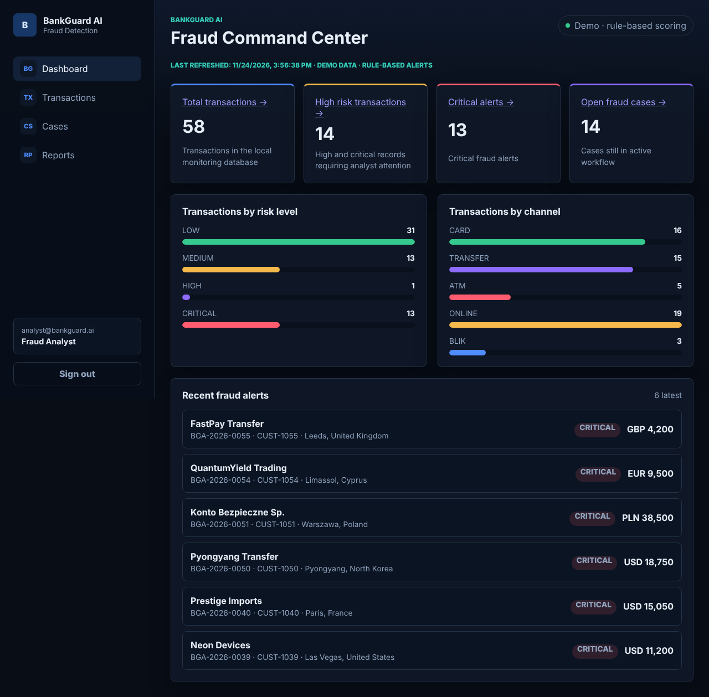
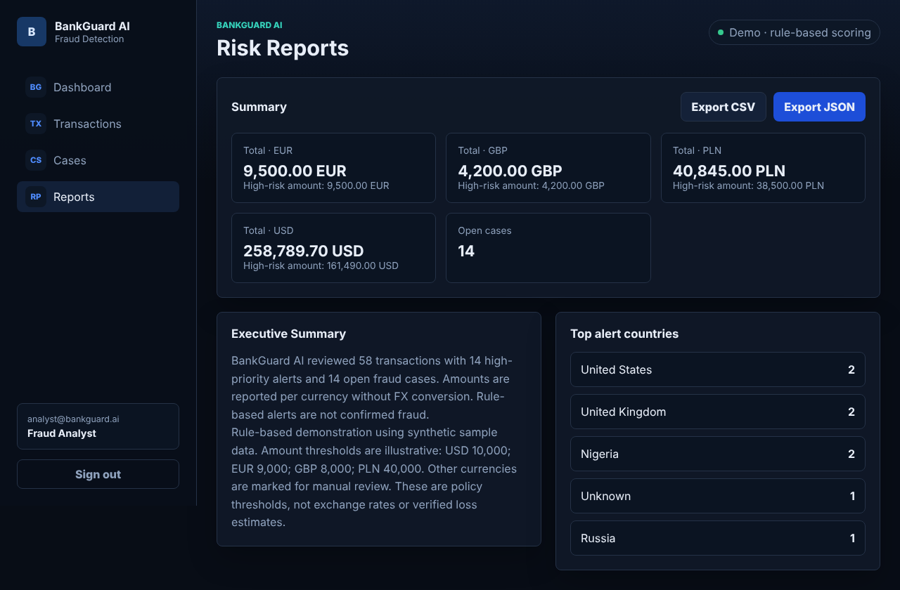

# BankGuard — analyst fraud dashboard demo

BankGuard is a portfolio demo for transaction review and case handling. An analyst can import a CSV, inspect explainable risk signals, update fraud cases, and export a summary. Its score comes from a transparent rule engine; there is no trained machine-learning model or confirmed-fraud ground truth.





## Run locally

Requirements: Python 3.12 and Node.js 24, matching the tested CI runtimes.

### 1. Start the API and load demo data

```bash
cd backend
python -m venv .venv
source .venv/bin/activate
pip install -r requirements.txt
export BANKGUARD_JWT_SECRET="$(python -c 'import secrets; print(secrets.token_urlsafe(48))')"
python seed.py
uvicorn app.main:app --reload
```

On Windows PowerShell, activate with `\.venv\Scripts\Activate.ps1` and set the secret with `$env:BANKGUARD_JWT_SECRET = (python -c "import secrets; print(secrets.token_urlsafe(48))")`.

The API runs at `http://127.0.0.1:8000`. The seed adds missing synthetic transactions and an analyst account; it does not delete existing transactions, cases or analyst notes. It prints a generated demo password once. Set `BANKGUARD_DEMO_PASSWORD` before seeding if you prefer to choose the password yourself. Set `BANKGUARD_DATABASE_URL` to store the SQLite database in another location.

### 2. Start the frontend

In another terminal:

Use Node.js 24, matching the frontend CI jobs. Install the locked dependencies:

```bash
cd frontend
npm ci
npm run dev
```

Open `http://localhost:5173`. Sign in with the email and password printed or configured during seeding. The session token lives in `sessionStorage` and is cleared on sign-out or when the API rejects it.

## What the demo demonstrates

- Protected analyst API routes with expiring JWTs and bcrypt password hashes
- CSV transaction import with UTC-normalized timestamps
- Rule-based scoring with a reason attached to each signal
- Searchable transaction monitoring and a case workflow with analyst notes
- Dashboard and report exports that keep currency amounts separate
- Repeatable local SQLite setup without Docker

CSV timestamps with an explicit offset are converted to UTC. Timestamps without an offset are interpreted as UTC. The report does not perform foreign exchange conversion: 100 USD and 100 PLN remain separate totals.

High-amount rules use illustrative thresholds of USD 10,000, EUR 9,000, GBP 8,000 and PLN 40,000. These are policy examples, not live exchange rates or calibrated fraud thresholds. Other currencies are marked for manual review. Alerts are not proof of fraud.

## Docker Compose

Docker is optional for local use. To run the container demo, create `.env` from `.env.example`, set a private `BANKGUARD_JWT_SECRET` and choose `BANKGUARD_DEMO_PASSWORD`, then seed the named volume and start both services:

```bash
cp .env.example .env
docker compose run --rm backend python seed.py
docker compose up --build
```

The seed runs only when explicitly requested. Compose binds ports to loopback and stores SQLite data in the `bankguard-data` volume. Keep that volume when recreating containers.

## Checks

Backend tests use a temporary SQLite database:

```bash
cd backend
python -m pip install -r requirements-dev.txt
ruff check .
python -m pytest -q
```

The suite has 105 tests across the scoring rules, API, authentication, backup, timestamp/currency contracts, import handling and idempotent seeding. The frontend checks and production build are:

```bash
cd frontend
npm run lint
npm run build
```

The Playwright scenario signs in, imports the sample CSV, saves case notes and status, exercises a failed-write retry, then checks logout and invalid-token behavior. It refreshes the screenshots shown above:

Chromium runs with its sandbox enabled. CI uses the runner's installed Google
Chrome; local runs can use a compatible sandboxed Chromium executable.

```bash
cd frontend
VITE_API_BASE_URL=http://127.0.0.1:18321 npm run build
cd ..
python -m pip install -r e2e/requirements.txt
E2E_API_PYTHON="$(pwd)/.venv/bin/python" PLAYWRIGHT_CHROMIUM_EXECUTABLE_PATH=/path/to/chromium .venv/bin/python -m pytest -q e2e
```

## Boundaries

Recovery checks (2026-11-16): 105 backend tests, frontend clean install/types/build
and the real FastAPI/SQLite browser scenario passed locally. Dependency checks
reported zero known vulnerabilities in 61 installed Python packages and the npm
lockfile. CI repeats both dependency audits and builds/runs the Compose images
with a disposable seeded volume. The recovery branch preserves the frontend
dependency changes from PR #3 and the currency/seed fixes already merged by PR #4.
Final CI evidence belongs to the recovery PR's exact commit; a Compose health
smoke test does not establish production hosting or detector accuracy.

The included transactions are synthetic. Risk thresholds are illustrative, reports do not convert currencies, and this project is not a bank service or a validated fraud model. The browser stores the short-lived session token in `sessionStorage`; use a server-managed `httpOnly` cookie and a production database before any real deployment.

## License

MIT. See [LICENSE](LICENSE).

## Role i rozliczalność (2026-11)

- `analysts.role`: `analyst` (pełny dostęp) lub `viewer` (tylko odczyt — import, nowe transakcje i decyzje w sprawach zwracają 403). Istniejące konta dostają `analyst` automatycznie przy starcie (dodanie kolumny jest idempotentne).
- Każda zmiana sprawy zapisuje `updated_by` (e-mail analityka).
- Listy `/api/transactions` i `/api/cases` przyjmują `limit` (domyślnie 500, maks. 1000) i `offset`.
- Frontend (nginx) wysyła CSP i nagłówki bezpieczeństwa — `connect-src` musi obejmować adres API z `VITE_API_BASE_URL` (`frontend/nginx.conf`).
