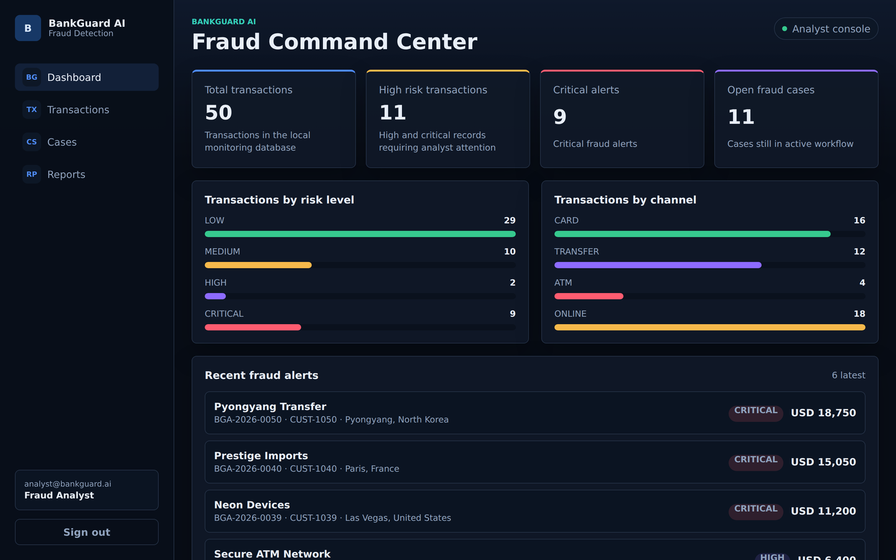
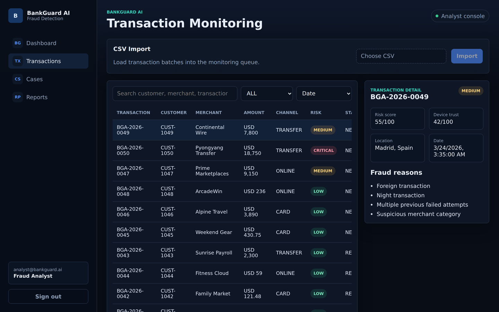
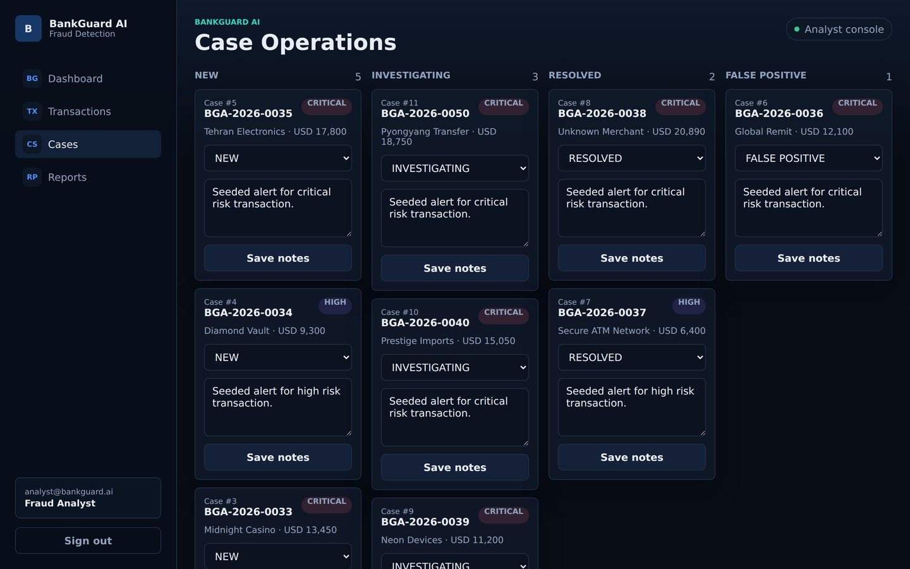
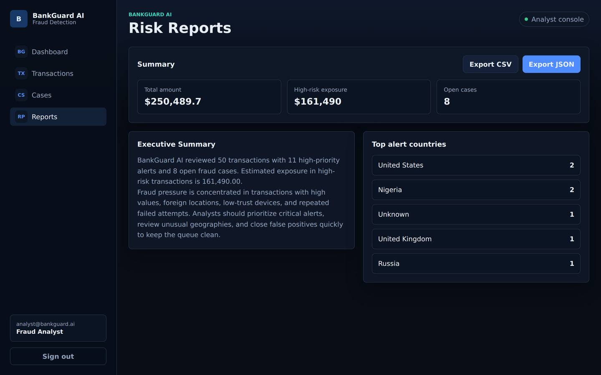
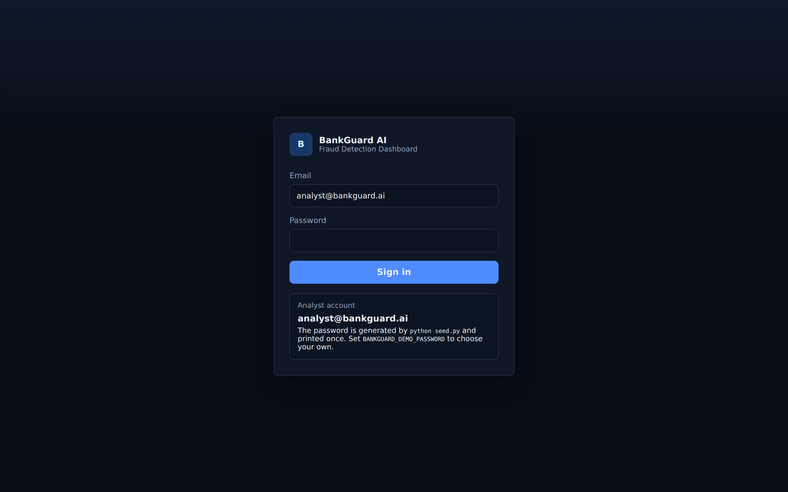

# BankGuard AI — Fraud Detection Dashboard

BankGuard is a fullstack fintech portfolio project that simulates a fraud analyst dashboard for a bank. It combines transaction monitoring, fraud scoring, case management, API design, reporting, frontend dashboard design, backend tests, and a clean monorepo structure.

> **About the name.** The repository is called `bankguard-ai`, but there is **no machine-learning model in it**. Scoring is an explainable rule engine — every point in a risk score is traceable to a named signal, which is the whole reason an analyst can act on it.
>
> This is a deliberate design choice, not a missing feature: in fraud triage, a reviewer has to justify a decision, and "the model said 0.87" does not survive that conversation. It is also a data constraint — `sample_transactions.csv` carries no fraud label (its `status` column tracks review workflow, not ground truth), so there is nothing to train a supervised model on without inventing outcomes.
>
> If a model is ever added, it belongs **alongside** the rules with labelled data behind it, not as a rename of what already exists.

## Why This Project Matters

Fraud detection is a high-impact banking problem where analysts need fast signal, clear evidence, and reliable workflows. This project demonstrates how a bank-facing internal tool can ingest transactions, score risk, open fraud cases, and summarize operational exposure in a practical dashboard.

## Tech Stack

- Frontend: React, TypeScript, Vite, plain CSS
- Backend: Python, FastAPI, SQLAlchemy, Pydantic
- Database: SQLite
- Auth: JWT (PyJWT) with bcrypt password hashing
- Testing: pytest, FastAPI TestClient — 78 tests
- Tooling: optional Docker Compose, GitHub Actions CI example

## Features

- Analyst login with a real, expiring JWT; every `/api` route verifies it
- Dashboard metrics for transactions, high-risk activity, critical alerts, and open cases
- Fraud scoring engine with analyst-readable reasons
- Transaction list with search, filtering, sorting, and detail view
- CSV transaction import
- Fraud case board with status updates and notes
- Reports summary with CSV and JSON export buttons
- SQLite database for local development without Docker
- Backend test coverage for fraud logic and core API endpoints

## Architecture

```text
bankguard-ai-fraud-detection/
  backend/   FastAPI API, SQLite models, fraud engine, seed script, tests
  frontend/  React TypeScript dashboard and API client
  .github/   CI workflow example for portfolio demonstration
```

The backend owns fraud scoring, persistence, API routes, CSV imports, dashboard aggregation, and report summaries. The frontend consumes the API through `frontend/src/api/client.ts` and presents an analyst-focused interface.

## Screenshots

Captured with Playwright against the running application — backend seeded from
`data/sample_transactions.csv`, frontend served from a production build. No
mockups.

### Fraud Command Center



Risk-level and channel breakdowns over the 50 seeded transactions, with the
most recent critical alerts. The counters are consistent by construction:
HIGH (2) + CRITICAL (9) equals the 11 shown as *high risk*.

### Transaction Monitoring



Search, channel filter and sort over the queue, with a detail panel showing the
risk score, device trust and — the part that matters for an analyst — the
**reasons** behind the score: foreign transaction, night transaction, repeated
failed attempts, suspicious merchant category. The score is explainable, not a
black box.

### Case Operations



Kanban board across NEW / INVESTIGATING / RESOLVED / FALSE POSITIVE. The board
in this screenshot was worked through the UI — six cases moved between columns —
so it shows the workflow in use rather than an untouched backlog.

### Risk Reports



Aggregate exposure, an executive summary generated from the current data, top
alert countries, and CSV / JSON export.

### Sign-in



JWT authentication; the analyst account is created by `seed.py` (see below).

## The analyst account

- Email: `analyst@bankguard.ai` (override with `BANKGUARD_DEMO_EMAIL`)
- Password: **generated by `python seed.py` and printed once.**

There is no password in this repository. Set `BANKGUARD_DEMO_PASSWORD` before
seeding to choose your own; leave it unset and a random one is generated,
shown on screen and stored only as a bcrypt hash.

## Authentication

`POST /api/auth/login` exchanges credentials for a signed JWT with a 30-minute
lifetime (`BANKGUARD_TOKEN_TTL_MINUTES`). Every other `/api` route requires
`Authorization: Bearer <token>`; `/health` stays public so probes do not need
to log in.

The signing secret comes from `BANKGUARD_JWT_SECRET` and **has no default** —
the API refuses to start without it. A key committed to source would let anyone
who can read this repository mint valid analyst tokens.

```bash
python -c 'import secrets; print(secrets.token_urlsafe(48))'
```

Login failures return one status and one message whether the address is
unknown, the password is wrong or the account is disabled — otherwise the
endpoint becomes a way to enumerate analyst accounts.

## How To Run The Backend

```bash
cd backend
python -m venv .venv
source .venv/bin/activate
pip install -r requirements.txt
python seed.py
uvicorn app.main:app --reload
```

On Windows PowerShell:

```powershell
cd backend
py -m venv .venv
.\.venv\Scripts\Activate.ps1
pip install -r requirements.txt
python seed.py
uvicorn app.main:app --reload
```

The API will run at `http://localhost:8000`.

## How To Run The Frontend

Use Node.js 24, matching the frontend CI jobs. Install the locked dependencies:

```bash
cd frontend
npm ci
npm run dev
```

The dashboard will run at `http://localhost:5173`.

## Seeding The Database

The seed file is located at `backend/data/sample_transactions.csv` and contains 50 realistic sample transactions across low, medium, high, and critical risk patterns.

```bash
cd backend
python seed.py
```

The seed script recreates the local SQLite tables, calculates fraud scores, and opens cases for high and critical transactions.

## API Endpoints

- `GET /health`
- `GET /api/dashboard/stats`
- `GET /api/transactions`
- `GET /api/transactions/{id}`
- `POST /api/transactions`
- `POST /api/transactions/import`
- `GET /api/cases`
- `PATCH /api/cases/{id}`
- `GET /api/reports/summary`
- `POST /api/auth/login`

## Fraud Scoring Rules

The engine in [`backend/app/fraud_engine.py`](backend/app/fraud_engine.py) turns a
transaction into a score from 0 to 100, a risk level and a list of
analyst-readable reasons. Every point is attributable to a named signal — that
traceability is the point, and it is what a reviewer needs to justify acting on
an alert.

### Signals and weights

| Signal | Condition | Points | Why it matters |
| --- | --- | ---: | --- |
| High amount | `amount > 10000` | **25** | Largest single weight: card-not-present fraud concentrates in high-value attempts, and the loss scales with the amount |
| Multiple previous failed attempts | `previous_failed_attempts >= 3` | **20** | Repeated failures before a success is the classic credential-stuffing and card-testing signature |
| Low device trust score | `device_trust_score < 40` | **20** | An unrecognised device is the strongest account-takeover indicator available without behavioural data |
| Foreign transaction | `is_foreign` | **15** | Raises the base rate, but far too common on its own to act on |
| Night transaction | `is_night_transaction` | **10** | Weak alone — it is a multiplier on other signals, not evidence by itself |
| Suspicious merchant category | crypto exchange, gambling, money/wire transfer, luxury goods, electronics | **10** | Categories that convert quickly to untraceable value |
| Unusual country or location | Belarus, Iran, North Korea, Nigeria, Russia, unknown | **10** | Geography is a weak, bias-prone signal; weighted low on purpose |

Matching is case- and whitespace-insensitive, because the CSV import is not
normalised upstream.

### Why the weights sit where they do

The seven signals sum to **110**, and the score is capped at 100 — so no single
transaction can be "more than certain", and the cap is covered by a test.

Deliberately, **no single signal can reach HIGH on its own.** The largest
weight is 25 and HIGH starts at 60, so an alert always rests on at least three
independent signals. That is what keeps a merely expensive legitimate purchase
out of the critical queue: 25 000 USD at a normal merchant, on a trusted
device, in daylight, scores 25 and stays LOW.

Geography and time of day are weighted lowest on purpose. Both correlate with
legitimate customer behaviour (travel, shift work) and both carry obvious bias
risk, so neither can drive an alert alone.

### Risk levels

| Score | Level | What it means for the queue |
| --- | --- | --- |
| 0–29 | `LOW` | No review |
| 30–59 | `MEDIUM` | Visible, not prioritised |
| 60–79 | `HIGH` | Opens a fraud case automatically on seed |
| 80–100 | `CRITICAL` | Top of the queue |

Boundaries are exact and tested: 29 is LOW, 30 is MEDIUM, 59 is MEDIUM, 60 is
HIGH. The amount rule is strictly greater-than, so exactly 10 000 does **not**
flag.

### Tuning

The weights and thresholds are constants in `fraud_engine.py`. Changing them
changes which transactions an analyst sees first, so
[`backend/tests/test_fraud_engine.py`](backend/tests/test_fraud_engine.py) pins
each weight, each threshold and each boundary — this table and those tests are
meant to stay in step.

## Tests

```bash
cd backend
BANKGUARD_JWT_SECRET=anything-for-tests pytest -q
```

**78 tests**, split across the two things worth protecting:

| File | Covers |
| --- | --- |
| `tests/test_fraud_engine.py` | Every signal's weight, every threshold boundary, the 100-point cap, case/whitespace handling, and CSV coercion (string numbers, truthy strings, malformed cells, missing fields) |
| `tests/test_auth.py` | Token issuing and expiry, forged and expired tokens, uniform rejection of bad credentials, every protected route refusing anonymous access, bcrypt hashing with per-password salt, and the refusal to start without a signing secret |
| `tests/test_api.py` | Health stays public; dashboard aggregates on an empty database |

## Optional Docker Compose

Docker is optional. The project is designed to run locally without containers.

```bash
docker compose up
```

## Portfolio Value

This project demonstrates:

- Fullstack development
- Fintech domain knowledge
- Fraud detection logic
- Dashboard design
- API design
- Testing
- Basic CI/CD

## Future Improvements

- Add authentication with JWT and role-based permissions
- Add model-based anomaly detection
- Add transaction velocity checks per customer
- Add audit logs for case updates
- Add pagination for larger datasets
- Add real charting with drill-down views
- Add PDF report generation

## Author

Pawel123j

## Weryfikacja środowiska — 2026-10-17

Naprawiono autoryzację uploadu CSV, usuwanie tokenu przy wylogowaniu, reakcję UI na 401 i zachowanie istniejących notatek przy ponownym zapisie. Import ogranicza odczyt do 10 MB, sprawdza UTF-8, kolumny i każdy rekord przez ten sam schemat co API; błędny wiersz odrzuca cały import przed zapisem. Kwoty nieskończone są odrzucane.

Backend: `cd backend && python -m pytest -q` — 89 PASS. Frontend: `cd frontend && npm ci && npm run build`. Browser E2E tworzy własną tymczasową SQLite i konto testowe; sprawdza rzeczywisty login, upload, sprawy, notatki, odświeżenie i logout. CI jest w `.github/workflows/browser.yml`. Dla lokalnego E2E zbuduj frontend z `VITE_API_BASE_URL=http://127.0.0.1:18321`; opcjonalnie `E2E_API_PYTHON` wskazuje interpreter z zależnościami backendu.

JWT pochodzi z `BANKGUARD_JWT_SECRET`; wartości w teście są wyłącznie testowe. Publiczna produkcja wymaga m.in. rozproszonego limitowania żądań, TLS, kontroli retencji i wersjonowanych migracji bazy. Scoring jest regułowy i korzysta z danych syntetycznych; testy nie dowodzą skuteczności na rzeczywistych oszustwach. Audyt npm frontendu: zero zgłoszeń po aktualizacji; nie jest to audyt całego systemu.


### Testy przeglądarkowe

Po zainstalowaniu zależności aplikacji i zbudowaniu frontendu zgodnie z README / workflow `browser.yml` (lub jobem browser w `ci.yml`):

```bash
python -m venv .venv-e2e
# Aktywuj ten venv przed dalszymi poleceniami.
python -m pip install -r e2e/requirements.txt
python -m playwright install chromium
python -m pytest -q e2e
```

Na Linux może być potrzebne `python -m playwright install --with-deps chromium` z uprawnieniami administratora. Alternatywnie `PLAYWRIGHT_CHROMIUM_EXECUTABLE_PATH` wskazuje istniejący Chromium. Testy uruchamiają i zatrzymują własny serwer, używają nowego kontekstu przeglądarki i zapisują logi w ignorowanym `e2e/artifacts/`. Pełny backend musi mieć zainstalowane swoje zależności; `E2E_API_PYTHON` jest opcjonalnym wyborem jego interpretera w AutoDesk/BankGuard. Testy nie uruchamiają wdrożenia.

## Walidacja etapu 2 — 2026-10-18

Logowanie ma limit 10 prób/5 minut na adres klienta, rezerwowany przed hashowaniem, także przy równoległych żądaniach. Zwraca 429 i Retry-After. Limit jest lokalny dla procesu; nie parsuje sam nagłówków proxy. Zaktualizowano FastAPI/Starlette, PyJWT, python-multipart i pytest po potwierdzonym audycie. Ponowny pip-audit zainstalowanego środowiska: 0 zgłoszeń.

Z katalogu backend: `python -m app.backup /ścieżka/bankguard.db /nowa/ścieżka/snapshot.db`. Narzędzie korzysta z SQLite online backup (w tym WAL), weryfikuje integralność, tworzy plik z prawami 0600 i odmawia nadpisania istniejącego pliku. Aby odtworzyć: zatrzymaj własne API, zachowaj oryginał, wykonaj osobną kopię poprawnego snapshotu i ustaw BANKGUARD_DATABASE_URL na tę kopię. Nigdy nie podmieniaj aktywnego pliku bazy. Schemat bieżącej wersji nadal inicjalizuje `create_all`; testowane jest powtórne uruchomienie, nie migracja przyszłych schematów.

95 testów PASS także po instalacji w nowym venv; E2E importu/spraw/awarii API/sesji i axe logowania/dashboardu PASS. Poprawiono kontrast przycisku. Czysta instalacja/build/audit frontendu PASS. Wynik oznacza lokalne demo analityczne; scoring regułowy nie został potwierdzony na rzeczywistych oszustwach.
